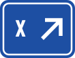

<picture>
  <source media="(prefers-color-scheme: dark)" srcset="assets/hero-dark.svg">
  
</picture>

I'm an AI engineer working across Bucharest and Deva, Romania, with knowledge in both Deep Learning and agentic solutions. I study Computer Science at Polytechnic University of Bucharest.

I am the founder of **TruckBroker**, the agentic solution for road freight transport, which is currently being built inside a road freight company.

## Repositories

<a href="https://github.com/popapatrick/AIBootcamp"><picture>
  <source media="(prefers-color-scheme: dark)" srcset="assets/aibootcamp-dark.svg">
  
</picture></a>

**[AIBootcamp](https://github.com/popapatrick/AIBootcamp)** is a prototype, built in a team of three for a PPC challenge, that lets the map of an electric grid update itself.

- Reads field reports and customer calls, matches them to the network and proposes changes to the map.
- Gives each change a confidence score with the reason behind it. Uncertain changes stay visible as predictions and are not applied.
- Predicts missing cable routes along OpenStreetMap streets. All network data is fictional.

`Python` `FastAPI` `OpenStreetMap` · MIT

<a href="https://github.com/popapatrick/DRONECOIN"><picture>
  <source media="(prefers-color-scheme: dark)" srcset="assets/dronecoin-dark.svg">
  
</picture></a>

**[DRONECOIN](https://github.com/popapatrick/DRONECOIN)** is a concept for a decentralized network of rooftop microphones that hears drones flying too low for radar.

- Nodes sign each detection, share it peer-to-peer and combine bearings into a position.
- A learned model matches sounds to the same drone, and nodes vote on its route through a Solana program.
- Includes the simulator, the peer-to-peer daemon, a map dashboard and a CAD design of the sensor.

> The project is not released, and I am not affiliated with any project with this name. The hardware is a design and some parts are not built yet. The [status section](https://github.com/popapatrick/DRONECOIN#status) lists what works.

`Python` `Rust` `TypeScript` `Solana` · All rights reserved

<a href="https://github.com/popapatrick/nvidia-nemotron"><picture>
  <source media="(prefers-color-scheme: dark)" srcset="assets/nemotron-dark.svg">
  
</picture></a>

**[nvidia-nemotron](https://github.com/popapatrick/nvidia-nemotron)** holds three solutions to the NVIDIA Nemotron Model Reasoning Challenge on Kaggle. Each one fine-tunes a rank-32 LoRA adapter on Nemotron-3-Nano-30B.

| Approach | Final leaderboard |
|---|---|
| Teacher chain-of-thought distillation | **0.83** |
| Solver-grounded equation engine with teacher chain-of-thought | 0.80 |
| Independent solver distillation, no external data | 0.74 |

The best adapter is on [Hugging Face](https://huggingface.co/popapatrick/nemotron-3-nano-reasoning-lora).

`Jupyter` `PyTorch` `LoRA` · MIT

## Milestones

- **HackTM winner**, with my team from Deva, for a medical compliance tool
- **2nd prize** at the Innovation Labs AI Bootcamp hackathon
- **National stage** of the Olympiads in Artificial Intelligence and Physics
- **First place, twice**, at the Hunedoara county stage in Physics

## Connect

<picture>
  <source media="(prefers-color-scheme: dark)" srcset="assets/motorway-dark.svg">
  
</picture>
